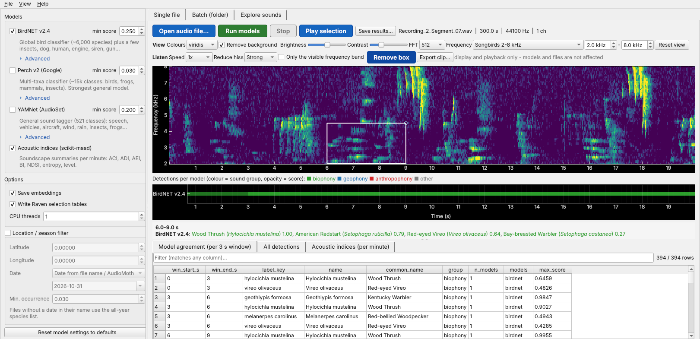
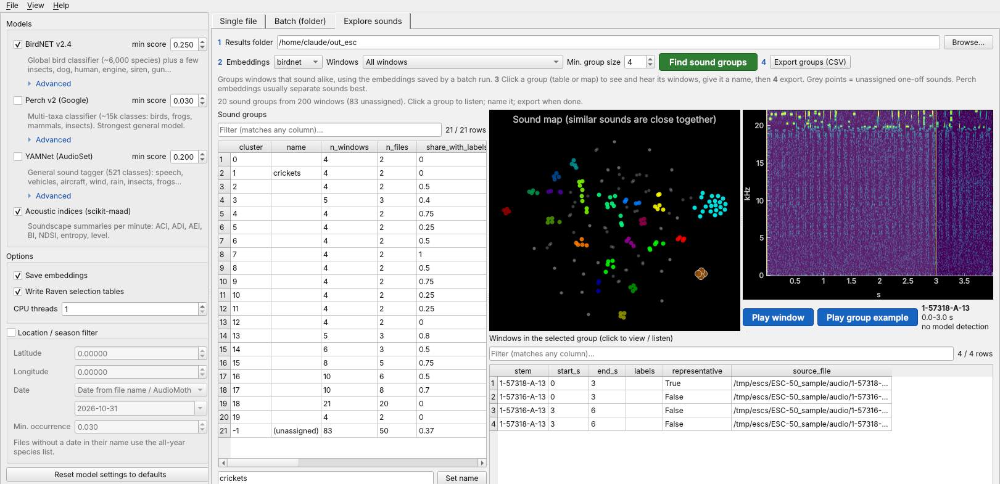
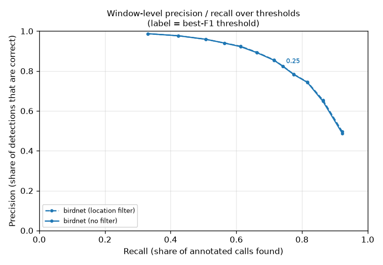

# BioTool – local multi-model bioacoustics processing

Desktop tool that runs several pretrained models over your recordings **on CPU, fully local**,
and merges their predictions into one set of tables so you can compare models side by side.
It also groups unknown sounds, filters species by location and season, and helps you listen
to and check detections.



| Component | What it detects | Window | Licence |
|---|---|---|---|
| **BirdNET v2.4** | ~6,000 bird species + a few insects, dog, human, engine, siren, gun | 3 s | CC BY-NC-SA 4.0 (non-commercial) |
| **Perch v2** (Google) | ~15k classes: birds, amphibians, mammals, insects (+ ~200 sound-event classes) | 5 s | Apache 2.0 |
| **YAMNet** (AudioSet) | 521 sound classes: speech, vehicles, aircraft, wind, rain, insects, frogs... | 0.96 s → 3 s | Apache 2.0 |
| **Acoustic indices** (scikit-maad) | ACI, ADI, AEI, BI, NDSI, entropy, level – per minute | 60 s | BSD |

Every model also saves **embeddings** (feature vectors per window) for clustering unknown sounds,
search-by-example and training custom classifiers later.

## Install (Windows)

0. Download the code: green **Code** button → *Download ZIP* (unzip anywhere), or
   `git clone` this repository.
1. Double-click **`setup.bat`** (once). It installs [uv](https://docs.astral.sh/uv/), Python 3.12
   and the dependencies into a local `.venv` folder (~1.5 GB, a few minutes).
2. Double-click **`BioTool.bat`** to start the app.
   If something goes wrong, use **`BioTool_debug.bat`** – it keeps a console open with error messages.

Models are downloaded automatically **the first time each one is used** and cached in
`%LOCALAPPDATA%\BioTool\models`:
- BirdNET (~60 MB) from PyPI,
- Perch v2 and YAMNet from Kaggle Models (public, no account needed).

Manual install (any OS): `uv sync` then `uv run biotool-gui`.

**Test data** – double-click **`GetTestData.bat`** (or `uv run biotool get-test-data`) to download
the BirdNET example recording, a 100-clip ESC-50 sample and a 20-minute Powdermill sample with
expert annotations (~110 MB in total) into `test_data\`.

## Using the app

**Handy:** *View → Theme* switches between Classic, Light, Grey and Dark. Drag an audio file onto the
window to open it (or a folder to use it for a batch run). Shortcuts: Ctrl+O open, Ctrl+R run models,
Ctrl+P play/stop. Only one job (model run, batch or grouping) runs at a time; the others wait.

**Single file tab** – *Open audio file…* shows the spectrogram; tick models on the left and press
*Run models*. Detections appear as coloured lanes under the spectrogram (one lane per model;
green = biophony, blue = geophony, red = anthropophony; opacity = score). Click anywhere on the
spectrogram or lanes to see what each model reported in that 3 s window; click a table row to jump
there; *Play selection* plays the highlighted section. *Save results…* writes the same outputs as a batch run.

**View and Listen controls** (Single file tab, display/playback only – models and files are never changed):
colour map, background removal, brightness/contrast, FFT size (2048 for low/tonal sounds such as frogs,
256 for fast clicks), frequency zoom with presets (birds 1–10 kHz, songbirds 2–8 kHz, low 0–2 kHz,
insects 4 kHz+). *Speed* slows playback (0.5×–0.1×, time expansion: pitch drops too) and *Only the
visible frequency band* plays through a band-pass filter matching the zoom – e.g. songbirds without the
wind rumble. *Reduce hiss* (light/medium/strong) removes steady in-band background noise while listening:
it learns the background from the quietest moments around the selection (spectral gating). *Draw box*
puts a resizable time × frequency box on the spectrogram; Play and Export then use exactly that box –
the best way to isolate one bird in a chorus (on a Wood Thrush test: background separation 3.8 dB →
18 dB with a 2–4.5 kHz box + strong hiss reduction). *Export clip…* saves a WAV copy of the selection
with the listening filters applied (named e.g. `..._bp2.0-4.5kHz_hissstrong.wav`). The Explore tab
uses the same speed/band settings for playback.

**Model settings** (left panel) – tick models and set each one's *min score*. Under *Advanced*:
BirdNET and Perch window overlap, BirdNET sensitivity (BirdNET's own convention: higher = more
detections), the maximum labels per window, YAMNet's grouping window (0.96–10 s) and method
(max = sensitive, mean = steadier), YAMNet classes to ignore, and the acoustic-index bands
(biophony / anthrophony bands for BI and NDSI, dB threshold for ADI/AEI). Under *Options*: the
*agreement grid* (time window used to compare models, default 3 s) and *skip quiet windows* (BirdNET/Perch
skip windows below an RMS level – faster on long quiet nights; check `rms_dbfs` first, as quiet
recorders sit around −45 to −60 dBFS). Window *lengths* are fixed by each model's training (BirdNET 3 s,
Perch 5 s); overlap is what you can change. *Reset model settings to defaults* restores
the tuned defaults (BirdNET 0.25, Perch 0.03, YAMNet 0.2). Everything is remembered between sessions.

**Location / season filter** (left panel) – enter the site's latitude/longitude. BirdNET's range
model then removes BirdNET/Perch species that are unlikely there at that time of year. The date comes
from the file name (AudioMoth/Song Meter style `20230415_063000`) or AudioMoth metadata, a fixed date,
or "all year". Files without a date use the all-year list. Removed detections are kept in
`removed_detections.csv` so nothing disappears silently. Settings are remembered between sessions.

**Species list** (left panel) – keep only, or remove, the species in a text file (one per line:
scientific name, English name or BirdNET's `Scientific_Common` format; `#` = comment). Applies to
BirdNET and Perch species; sound-event classes are never affected. Removed detections are also logged
in `removed_detections.csv` (column `removed_by`).

**Analyse selection** (Single file tab, Ctrl+E) – runs the ticked models on just the current selection
or box, with windows every 0.5 s, and shows each model's top labels for that stretch in a small window
(nothing is saved; *Copy table* for a spreadsheet). Handy for a second opinion on one call. *Filter to
box band* also band-passes the audio first – usually worse, because the models were trained on
unfiltered audio.

**Batch tab** – choose a recordings folder (subfolders included) and an output folder, press *Start*.
Finished files are recorded, so a stopped or crashed run continues where it left off when restarted
with the same settings (changing models or thresholds re-processes everything).



**Explore sounds tab** – groups windows that sound alike, using the embeddings saved by a batch run
(PCA + HDBSCAN clustering; groups are found automatically, one-off sounds stay *unassigned*).
Choose which windows to include – *no species identified* (default; for finding unknown sounds),
*no detection at all*, or *all windows* – then click a group or a point on the sound map to see its
spectrogram and listen. Name groups you recognise and *Export* them (`sound_groups_<model>.csv`),
e.g. as training examples for a custom classifier later. Perch embeddings usually separate sounds best.

## Evaluating the models

Double-click **`Evaluate.bat`** (after `GetTestData.bat`). It runs the models on the annotated test data in `test_data\`
(once, at low thresholds; cached) and opens `evaluation\evaluation_report.html` with:
- **Powdermill** (expert-annotated dawn chorus): precision / recall / F1 per model over a range of
  thresholds (with the best threshold), with and without the location filter; BirdNET OR / AND Perch;
  and per-file species lists (correct / missed / not annotated).
- **ESC-50 sample**: how often each model puts a clip in the right sound group, per category.

**High-pass experiment** – `HighpassTest.bat` repeats the evaluation with high-pass filters at
300 / 500 / 1000 Hz (applied only to the audio the models see) and puts a comparison table at the top
of the report. First result: BirdNET gets clearly *worse* with any high-pass (its confidence drops when
the low-frequency background is removed), so don't pre-filter for BirdNET. Single runs:
`uv run biotool run <in> <out> --highpass 300`.



Command line: `uv run biotool evaluate --powdermill <wav folder> --powdermill-annotations <folder>
--powdermill-readme <README.txt> --esc50 <ESC-50_sample> --output evaluation`

## Outputs (per run folder)

| File | Content |
|---|---|
| `detections_all.csv` | every detection: file, start/end, model, label, scientific/common name, group, score |
| `species_agreement.csv` | per 3 s window and label: how many / which models detected it, best score |
| `groups_per_window.csv` | per 3 s window: which models heard biophony / geophony / anthropophony, top labels |
| `species_summary.csv` | per file and label: models, first time, max score, detections per model |
| `indices_all.csv` | acoustic indices per file per minute |
| `embeddings/<file>__<model>.npz` | `start_s` + `embeddings` arrays (float16) |
| `raven/<file>.selections.txt` | Raven Pro selection tables for review |
| `per_file/` | per-file tables + `.done.json` markers (used for resuming) |
| `removed_detections.csv` | detections dropped by the location filter / species list, with `removed_by` |
| `sound_groups_<model>.csv` | exported sound groups from the Explore tab |
| `run_config.json`, `errors.csv` | settings used; files that failed and why |

Command line (same engine):
```
uv run biotool run D:\recordings D:\results --models birdnet,perch_v2,yamnet,indices --threshold birdnet=0.3
uv run biotool run D:\recordings D:\results --lat 52.37 --lon 4.89 --date file   # with location filter
```

## Notes on interpretation

- **Perch scores are softmax shares**: they sum to 1 per window, so when 3 species call together each
  gets ~0.3. That's why its default minimum is 0.03, the best value on the Powdermill test (BirdNET 0.25, YAMNet 0.2). Use `Evaluate.bat` to tune.
- **Scores are not comparable across models** – 0.6 from BirdNET ≠ 0.6 from Perch. Use per-model
  thresholds, and ideally calibrate them on a few validated files from your own sites.
- **Agreement is a useful confidence signal**: a species reported by both BirdNET and Perch in the same
  window is much more likely to be right than one reported by a single model at a low score.
- Species are matched across models by **scientific name**; occasional taxonomy differences
  (splits/lumps between eBird and iNaturalist naming) can make the same species appear twice.
- Sample rate: BirdNET needs 48 kHz, Perch 32 kHz, YAMNet 16 kHz. Lower-rate files are upsampled with a
  warning (nothing above the file's Nyquist frequency can be detected).

## Adding a model

Write an adapter in `src/biotool/models/` (subclass `ModelAdapter` in `base.py`: set `samplerate`,
`window_s`, implement `load()` and `process()` returning rows in the shared schema), then register it in
`models/__init__.py`. It appears in the app automatically.

## Project layout
```
src/biotool/
  audio.py        reading, streaming in 60 s blocks, resampling, framing
  models/         one adapter per model + acoustic indices
  merge.py        agreement / group / summary / Raven tables
  pipeline.py     Engine (loads models once), single-file + folder runs with resume
  location.py     BirdNET range model: location / season species filter
  evaluate.py     scoring against Powdermill + ESC-50, HTML report
  explore.py      embedding clustering for the Explore tab
  downloads.py    first-use model downloads and cache
  gui/            PySide6 desktop app
  cli.py          command line
```

## Development

```
uv sync --group dev
uv run pytest            # fast unit tests, no models or network needed
```
The same tests run on GitHub Actions (Windows and Linux) for every push. See `ROADMAP.md` for planned work.

## Licence and credits

BioTool's own code is released under the **MIT licence** (see `LICENSE`). The models and datasets it
downloads keep their own licences – please respect and cite them:

| Component | Licence | Cite |
|---|---|---|
| BirdNET v2.4 model + range (meta) model | CC BY-NC-SA 4.0 – **non-commercial** | Kahl et al. (2021) BirdNET: A deep learning solution for avian diversity monitoring. *Ecological Informatics* 61 |
| Perch v2 | Apache 2.0 | van Merriënboer et al. (2025) Perch 2.0: The Bittern Lesson for Bioacoustics. arXiv:2508.04665 |
| YAMNet | Apache 2.0 | Google Research, TensorFlow Model Garden (AudioSet ontology: Gemmeke et al. 2017) |
| scikit-maad | BSD-3 | Ulloa et al. (2021) scikit-maad. *Methods in Ecology and Evolution* 12 |
| Powdermill test data | free use, please cite | Chronister et al. (2021) *Ecology* 102: e03329 |
| ESC-50 test data | CC BY-NC (ESC-10 subset CC BY) | Piczak (2015) ESC: Dataset for Environmental Sound Classification. ACM Multimedia |

Because BirdNET's model is non-commercial, results produced with it inherit that restriction.
